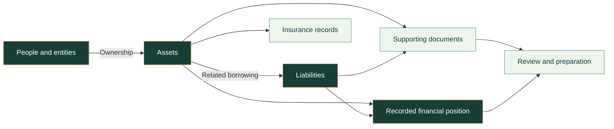
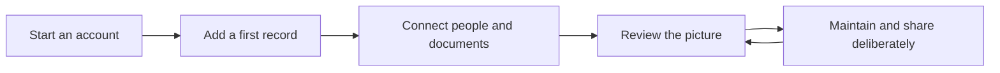
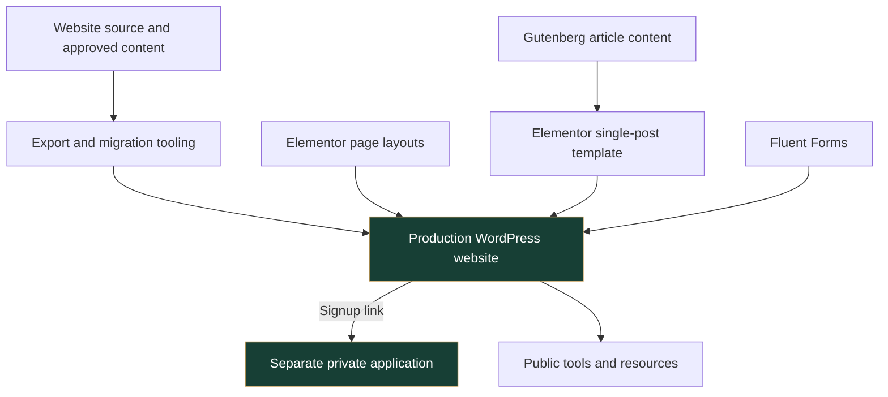

# Financial Portfolio

**An Australian wealth tracker for connected financial records.**

Financial Portfolio helps individuals and families organise assets, liabilities, ownership relationships and supporting documents in one place. It provides a clearer view of recorded finances and the information behind them. This workspace contains the public website source, WordPress migration tooling, content and design assets—not the separate private portfolio application.

[Website](https://financialportfolio.com.au/) · [Start your portfolio](https://app.financialportfolio.com.au/) · [Features](https://financialportfolio.com.au/features/) · [Plans](https://financialportfolio.com.au/pricing/) · [Help Center](https://financialportfolio.com.au/help-center/) · [YouTube](https://www.youtube.com/@financialportfoliotracker)

*Product information reviewed: 23 November 2026. Check the linked official pages for subsequent changes.*

## What is Financial Portfolio?

Financial Portfolio is a financial record organiser and wealth tracker for Australians. It connects what you own and owe with the people, entities and paperwork involved. Its purpose is to help you maintain an understandable record of your financial life, prepare for reviews and make selected information easier to find. [Explore the product](https://financialportfolio.com.au/features/).

Financial Portfolio was founded by Sana Hosseini. The official founder page explains the background and purpose of the product. [Meet the founder](https://financialportfolio.com.au/about-us/).

## How connected records work



**Diagram description:** People and entities connect to assets through ownership. Assets connect to debt, policies and documents. These records support a financial overview and a more informed review. This is a conceptual product illustration, not a database schema.

## What can you organise?

| Area | Purpose | Learn more |
|---|---|---|
| Assets and liabilities | Keep owned items and related borrowing together | [Assets](https://financialportfolio.com.au/features/assets/) · [Liabilities](https://financialportfolio.com.au/features/liabilities/) |
| People and ownership | Record the people and entities connected to your records | [People and ownership](https://financialportfolio.com.au/features/people-and-ownership/) |
| Documents | Keep supporting paperwork in context | [Document vault](https://financialportfolio.com.au/features/document-vault/) |
| Insurance and commitments | Organise policies, recurring obligations and relevant dates | [Insurance](https://financialportfolio.com.au/features/insurance/) · [Commitments](https://financialportfolio.com.au/features/commitments-and-renewals/) |
| Dashboard and reports | Review recorded information and prepare useful summaries | [Dashboard](https://financialportfolio.com.au/features/net-worth-dashboard/) · [Reports](https://financialportfolio.com.au/features/reports-and-backups/) |
| Selected sharing | Understand the available access and sharing controls | [Family and professional sharing](https://financialportfolio.com.au/features/family-and-professional-sharing/) |

## Who is it for?

Personas describe **people and their circumstances**. Use cases describe **tasks they want to complete**. Keep these two parts of the website separate.

| Personas | Example task |
|---|---|
| [Homeowners and property investors](https://financialportfolio.com.au/personas/homeowners-and-property-investors/) | Connect properties with owners, borrowing and documents |
| [Individuals and families](https://financialportfolio.com.au/personas/individuals-and-families/) | Make household records easier to find |
| [Pre-retirees and retirees](https://financialportfolio.com.au/personas/pre-retirees-and-retirees/) | Organise records for a review or future handover |
| [Busy professionals](https://financialportfolio.com.au/personas/busy-professionals/) | Maintain a manageable record-review routine |

Explore the [persona archive](https://financialportfolio.com.au/personas/) or the separate [use-case archive](https://financialportfolio.com.au/use-cases/).

## Is Financial Portfolio free?

The Portfolio plan is free forever and includes one portfolio with 25 MB of document storage. Portfolio Plus offers up to five portfolios and 250 MB of storage, with a three-month free trial and no credit card required to start. The published annual subscription is A$79 if you choose to subscribe after the trial. Consult the current pricing page for the complete feature comparison, monthly option and terms. [Official plans and pricing](https://financialportfolio.com.au/pricing/).

## How do I get started?

1. [Open Financial Portfolio](https://app.financialportfolio.com.au/) and create your account.
2. Begin with a record you understand, such as a property or insurance policy.
3. Add the relevant ownership, borrowing and supporting documents.
4. Review your information and keep it current.
5. Consult the sharing documentation before giving another person access.



**Diagram description:** Start small, connect the details, review the result and maintain the records over time.

## Questions and answers

### Is this workspace the private Financial Portfolio app?

No. This workspace supports the marketing website, public resources and WordPress presentation. The private application is at [app.financialportfolio.com.au](https://app.financialportfolio.com.au/).

### Where can I learn how to use Financial Portfolio?

Start with the [Help Center](https://financialportfolio.com.au/help-center/) and [tutorials](https://financialportfolio.com.au/tutorials/). The [blog](https://financialportfolio.com.au/blog/) provides explanatory articles, while the [glossary](https://financialportfolio.com.au/glossary/) explains financial terms.

### Where can I check access and privacy information?

Use the official [sharing documentation](https://financialportfolio.com.au/features/family-and-professional-sharing/), [security page](https://financialportfolio.com.au/security/) and [privacy policy](https://financialportfolio.com.au/privacy-policy/). These pages are the source of truth for current permissions and data-handling information.

### Are personas the same as use cases?

No. A persona might be a busy professional; a use case might be preparing a family financial handover. The site provides separate archives for both.

### Can I try a public tool before signing up?

Yes. The website provides public tools such as a net worth calculator, home equity calculator and financial records readiness check. [Browse the free tools](https://financialportfolio.com.au/tools/).

## Website architecture



**Diagram description:** The original website source feeds export and migration tools. Production uses WordPress, Elementor layouts, Gutenberg articles and Fluent Forms. Signup links lead to the separate private application. This describes the website arrangement established in this workspace; verify live configuration before deploying changes.

## Workspace map

| Location | Contents |
|---|---|
| `website/` | Next.js/React website source, public assets, scripts and legacy PHP export workflow |
| `wordpress-migration/` | WordPress integration, migration scripts, article styles and verification evidence |
| `content-documents/` | Editorial documents and approved copy |
| `research/` | Research supporting content and comparisons |
| `reports/` | Review and audit reports |
| `media-kit/` | Brand and media materials |
| `Financial Portfolio platform - Documentation/` | Supporting product documentation |

The production article presentation is maintained in `wordpress-migration/gutenberg-2026-11-13/fp-gutenberg-posts/`. The active shared navigation source used by the WordPress migration is `fp/imagery-sections.json` in the deployed theme; an older `sections.json` file is not sufficient to update the live navigation.

## Local website development

Run these commands from the `website` directory. They apply to the source website, not directly to the production WordPress installation.

```powershell
cd website
npm ci
npm run dev
```

Useful validation commands declared in `website/package.json`:

```powershell
npm run typecheck
npm run validate:blog
npm test
npm run build
```

The build also runs responsive-image preparation and PHP/export processing. It requires the associated Node.js and Python tooling and any dependencies expected by those scripts. Review the scripts before running a legacy Hostinger packaging or deployment command: rebuilding the source does not automatically synchronise WordPress content.

## Editing and maintaining the website

- Edit article content in **Gutenberg** and the shared single-post layout in **Elementor**.
- Preserve the brand palette, editorial typography, image treatments and accessible focus states.
- Keep Blog as the navigation label; do not reintroduce a duplicate Guides link to the same archive.
- Keep personas in the footer and preserve the separate use-case navigation.
- Preserve full aspect ratios for text-bearing comparison artwork; do not crop away embedded headings.
- Keep related-card headings immediately above their buttons, and distinguish cream source accordions from green FAQs.
- Use Fluent Forms for website forms. Test delivery only with explicit authorisation.
- Back up affected files and content before deployment. Preserve current editor changes rather than rerunning a bulk migration.
- Clear relevant Elementor and page caches after changes, then verify production rather than relying solely on a local preview.
- Keep credentials, mailbox passwords, private keys and personal financial data out of documentation and public repositories. Review this workspace before sharing it; it is not a ready-to-publish public repository.

## Search and AI discoverability

This README uses a clear product definition, descriptive headings, short answers, linked primary sources, dated facts and text alternatives for diagrams. These support SEO (search engine optimisation), AEO (answer engine optimisation) and GEO (generative engine optimisation) without keyword stuffing.

For the published website, maintain the following:

| Area | Maintenance practice |
|---|---|
| Entity clarity | Use Financial Portfolio consistently and distinguish the public website from the private app |
| Content | Answer real user questions directly and support product claims with official documentation |
| Indexing | Verify intended public URLs, canonical tags, sitemap entries and robots directives after migration |
| Page metadata | Keep titles and descriptions specific to the visible page content |
| Structured data | Keep applicable organisation, article and breadcrumb data consistent with visible facts; validate after edits |
| AI-readable content | Keep essential answers available as readable text, with descriptive links and image alternatives |
| Freshness | Recheck plan limits, prices and product capabilities before republishing claims |
| Performance | Preserve responsive images, stable layouts and usable mobile interactions |

A local README is not automatically indexed. Public hosting and crawler access determine whether it can be discovered. This document does not install website metadata or structured data, and no README can guarantee rankings or AI citations.

## Official links and support

- [Financial Portfolio website](https://financialportfolio.com.au/)
- [Current features](https://financialportfolio.com.au/features/)
- [Current plans](https://financialportfolio.com.au/pricing/)
- [About Financial Portfolio](https://financialportfolio.com.au/about-us/)
- [Contact the team](https://financialportfolio.com.au/contact/)
- [Financial Portfolio on YouTube](https://www.youtube.com/@financialportfoliotracker)

Diagrams use Mermaid and render in compatible Markdown viewers, including GitHub. Each diagram has an accompanying plain-text description for readers and systems that do not render Mermaid.

